<div align="center">


# Penguin Protocol

**Learn Linux by going undercover.**

A realistic terminal simulator with 50 covert missions and 10 vaults,<br>
from your first `ls` to a live incident.

<br>

<a href="https://nfvlogic.github.io/Penguin-Protocol/"></a>

<br><br>



<sub>Meet **Pip**, your partner inside Atlas.</sub>

<br>


<a href="https://github.com/nfvlogic/Penguin-Protocol/actions/workflows/tests.yml"></a>

<br>

[Story](#the-story) · [Demo](#demo) · [Features](#features) · [Quick start](#quick-start) · [Browser](#play-in-the-browser) · [How to play](#how-to-play) · [Curriculum](#curriculum)

</div>

<br>

## The story

You are an operative with an engineer's badge, planted inside a company called **Atlas**. Your handlers (Control,
the Quartermaster, Counter-intel, Watchtower) send you briefings, and every mission is a situation you would meet
at work: an error hidden in a log, a full disk, a service that will not start, a file that anyone can read.
Stay quiet, find the evidence, leave no trace.

You solve them with **real commands**. The shell is a faithful simulation of bash on Ubuntu, so options, exit codes
and error messages match what you will see on a real server.

**Pip**, a tiny pixel penguin in an orange deerstalker, is your partner in the field. He explains each mission in
plain words, names the trap when an answer is off, and celebrates your firsts. Every five missions he leads you into
a **vault**: a boss mission that combines everything you just learned.

> [!NOTE]
> Everything runs in memory. Nothing touches your real files, so you can break things freely.

<br>

## Demo

<div align="center">
  
  <br>
  <sub>The first mission, solved. Every new game has its own answers, so yours will differ.</sub>
</div>

<details>
<summary>Plain-text version</summary>

```text
 ▄█▀█▀█▄   Your badge got you in. Prove your cover holds.
 ▀█▀▀▀█▀

──────────────────────────────────────────────────────────────────────────
 ATL-101  Operation Front Door                                Threat: Low
 Handler: Control   Phase: Infiltration   File 1 of 60
 Password: PP-01-WYYR-3VU5
──────────────────────────────────────────────────────────────────────────
 BRIEFING                          │ TOOLKIT (examples: other files)
 Control wants proof that your     │ ls [FOLDER]
 cover holds: run Atlas on your    │   list the files in a folder (e.g. ls
 own machine.                      │   reports)
                                   │ cat FILE
 Start with welcome.txt in your    │   show what is inside a file (e.g.
 home folder: it points to the     │   cat notes.md)
 project docs. Find the port the   │ cd FOLDER
 app uses locally.                 │   go into a folder; cd .. goes up, cd
                                   │   ~ goes home (e.g. cd projects)
 You start in ~ (your home folder, │
  /home/analyst). Paths in this    │
 briefing start there. In it:      │
 atlas/  notes.txt  welcome.txt.   │
                                   │
 MISSION COMPLETE WHEN             │
 You submit the local port number. │
                                   │
 Found the answer? Type:  submit   │
 ANSWER                            │
──────────────────────────────────────────────────────────────────────────
 Always available: ls cd pwd cat less tree man   Mission: task  check
   hint  submit  password

Pip: First time? Type  ls  to see what is here.

Pip: First time? Type  ls  to see what is here.
analyst@penguin:~$ cat welcome.txt
Welcome to the Atlas team!
The code is in ~/atlas. Start with README.md there.
analyst@penguin:~$ submit 8080

 ▄█▀█▀█▄   Wrong answer, try again.
 ▀█▀▀▀█▀   Old notes lie. The project README says how the app runs today.

analyst@penguin:~$ cd atlas
analyst@penguin:~/atlas$ cat README.md
# Atlas
Internal stage-gate app (Flask + MySQL). Formerly COMPASS.

Run locally:
  flask run --port 5050

More setup help: docs/setup.md
analyst@penguin:~/atlas$ submit 5050

 ▄█▀█▀█▄   ✓ Objective secured: Operation Front Door (ATL-101)
 ▀█▀▀▀█▀   Nice work, partner.
```

</details>

<br>

## Features

| &emsp;&emsp;&emsp;&emsp; | Feature | What you get |
|:-:|---|---|
|  | **A real shell** | Pipes, redirects (`>`, `2>&1`, here-documents), variables, `$(...)`, arithmetic, brace expansion, `for` / `while` / `if`, aliases, history and Tab completion. |
|  | **60+ commands** | `grep`, `find`, `sed`, `awk`, `tar`, `ssh`, `systemctl`, `journalctl`, `ps`, `kill`, `curl`, `chmod`, `ln`, `git` and more, with a built-in manual (`man`). |
|  | **Real permissions and errors** | Ownership, `chmod` modes and "Permission denied" behave as on Linux. |
|  | **Missions with a story** | Fifty briefings with codenames, handlers and phases, from your first day inside to the final operation. |
|  | **Pip, your partner** | Explains each mission in plain words, names the trap after a wrong answer, hops at your first pipe, redirect or `grep`, and cheers next to the answer bar. |
|  | **Ten vaults** | After every five missions comes a boss mission with its own gold card, Pip walking in with a golden key, and a bigger celebration when you crack it. |
|  | **Clear cards** | The goal (or a checklist that ticks itself), every tool with its meaning and an example, and new tools marked **new**. The whole briefing is always on the card, with a tree of what your folders must look like when you are done. |
|  | **Guided learning** | Three levels of hints, plus the manual. Wrong answers name the trap you probably fell into. |
|  | **Runs anywhere** | Terminal on Windows, macOS and Linux, or in the browser as an installable app with its own phone keyboard. |
|  | **Portable progress** | Every level has a password, so you can continue on any computer. |

<br>

## Quick start

| System | Start |
|---|---|
| **Windows** | Double-click `PenguinProtocol.bat` |
| **macOS / Linux** | Double-click `PenguinProtocol.command` (first time: right-click, Open) |
| **Any terminal** | `python3 penguin.py` (Windows: `py -3 penguin.py`) |

Requires Python 3.10 or newer. No packages to install.

<br>

## Play in the browser

**Play now: <https://nfvlogic.github.io/Penguin-Protocol/>**

The same game runs in a web page (the real Python code, through Pyodide) and installs like an app. On an iPhone open
the page in Safari, then Share, Add to Home Screen. It works offline after the first load and keeps your progress on
the device.

**On a phone** held upright, the page shows its own on-screen keyboard, with a row of terminal keys above it (Tab,
Ctrl+C, Ctrl+D, `|`, `>`, `<`, `~`, `*`, `=`, `;`, `&`, `/`, `-`, `$`, quotes and history arrows). The **Kbd** key
switches between that keyboard, the phone's own keyboard and none. Tapping the output hides the keyboard; tapping
the prompt brings it back.

**On a computer** (or with the phone on its side), the normal keyboard is used.

To build and try it locally:

```bash
python3 tools/build_web.py
python3 -m http.server -d site
```

Pushing to `main` publishes it with GitHub Pages (`.github/workflows/pages.yml`).

<br>

## How to play

Each mission card shows Pip's briefing, the goal (or a checklist that ticks itself), and the tools you will need,
with an example for each, and a tree of the end result when you have to create files. `task` shows the card again. Answer missions end with `submit`; missions marked
"closes by itself" finish as soon as everything on the checklist is true (`check` shows it).

```text
tasks           list all missions and your progress     hint          get help (3 levels)
task            show the current mission again          check         see which requirements are met
submit ANSWER   send your answer                        man COMMAND   read a manual page
reset           rebuild the files of the mission        help          list every command
level N         go to level N (password needed)         newgame       start over with new answers
newgame +       New Game+ (after you beat the game)     mode          show guided or New Game+
```

Finishing a mission unlocks the next one. Every new game has its own answers, saved with your progress.

> [!TIP]
> **Continue anywhere.** After each vault the game prints the **password** of the next level. On any computer, type
> `level 10` and enter the password of level 10 to start there. Levels you have already reached need no password,
> and `password` shows the current one again.

<br>

## New Game+

Once you beat all 60 missions, **New Game+** unlocks: type `newgame +` for a new run with new answers where cards
show only the briefing, there are no tips under errors, and you get one hint per mission. It is meant to feel like
doing the job for real, with just `man` and your memory. The password to unlock it on another computer is printed
when you finish the game.

<br>

## Command line

```text
python3 penguin.py              continue your game (or start a new one)
python3 penguin.py --new        start a new game with new answers
python3 penguin.py --plus       start New Game+ (needs a beaten game, see above)
python3 penguin.py --seed 42    use answer set 42 (the same number gives the same answers)
python3 penguin.py --version    show the version        --help   show all options
```

The built-in manual (`man grep`, `man find`, ...) has a description, options, examples, exit status and related
commands, like a real manual page.

<br>

## Curriculum

| Phase | Missions | Focus |
|---|:-:|---|
| Infiltration | 7 | Navigating, files and folders, globs, hidden files, redirects |
| Reconnaissance | 6 | `find`, `grep` and its options, `head`, `tail`, `wc` |
| Surveillance | 3 | `cut`, `sort`, `uniq`, chaining commands, running scripts |
| Forensics | 6 | `tr`, `diff`, `sed`, `awk`, `xargs`, Windows line endings |
| Lateral movement | 3 | Networking, `ping`, `ssh`, `/etc/hosts`, disk space |
| The back channel | 4 | `curl`, headers, tokens, shell variables |
| Deep cover | 5 | Virtual environments, `git`, environment variables |
| Inside the walls | 7 | Processes, permissions, services, logs, archives, accounts |
| Tradecraft | 4 | Loops, redirection, `find` with `tar`, symbolic links |
| The final operation | 5 | Multi-step cases that combine everything |
| **The Vault** | 10 | One boss after every 5 missions, combining exactly what those 5 taught |

<br>

## Testing

```bash
cd tests && python -m unittest -v
```

The suite runs a full walkthrough of every mission and checks the shell against real Linux behaviour.
`tests/test_web.py` checks that the web page, its script and the game agree with each other (it needs no browser).

`python3 tools/make_demo.py` rebuilds the animated demo and `python3 tools/make_pip.py` the picture of Pip, both
from the game itself.

<br>

## Contributing

Add a `task(...)` entry in `penguin/tickets.py`, and in `penguin/missions.py` its codename and story line (`STORY`),
what has to be done (`TASK`), Pip's lines (`PIP`, `TODO`) and the trap Pip names after a wrong answer (`WRONG`).
Vaults live in `penguin/vaults.py`.

Card examples must use other files, folders and hosts than the mission and must never contain an answer; the tests
check this. Add a first-level hint in `NUDGES` (`penguin/tickets_data.py`) and the solution to `WALKTHROUGH` in the
tests.

<br>

## License

Copyright (c) 2026 nfvlogic. All rights reserved.

You are welcome to view the code and run the game for your own learning. For anything else, such as copying, sharing,
changing, teaching with it or using it in a company, please ask first by opening an issue. See [LICENSE](LICENSE).
